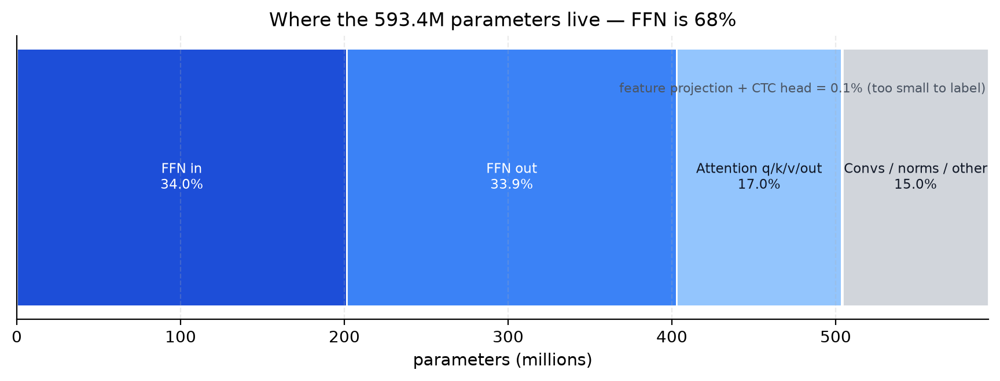
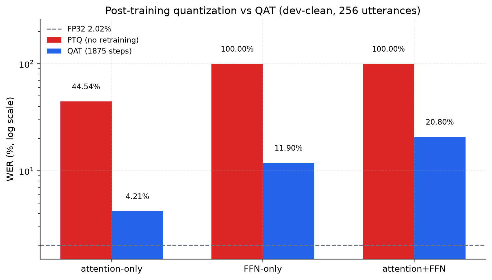
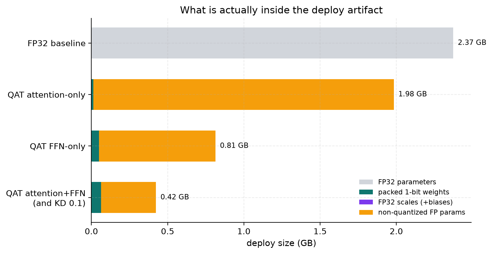
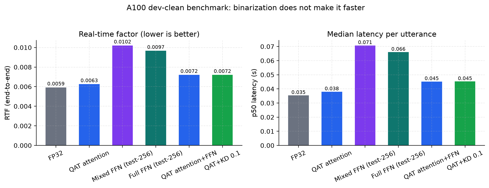
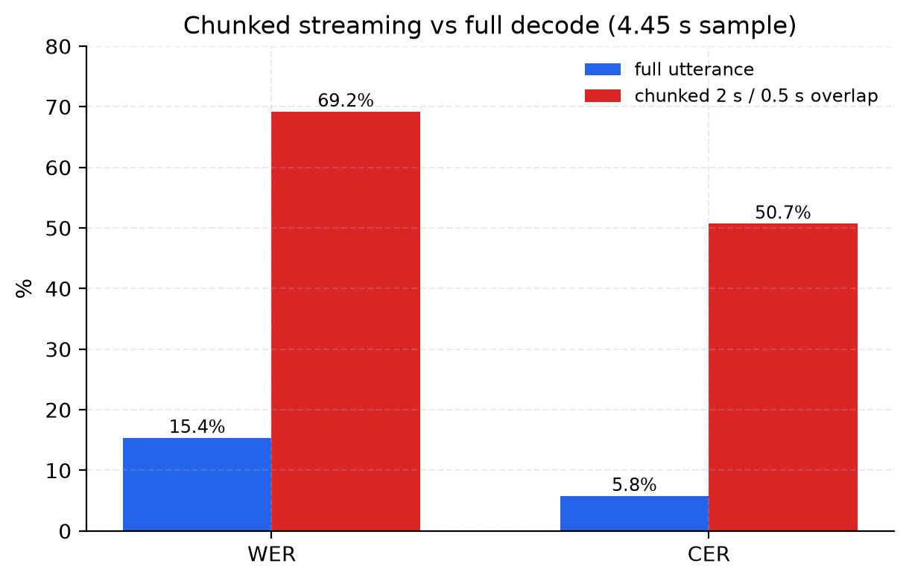

# Deep dive: 1-bit Wav2Vec2-Conformer ASR

This is the "teach me the whole project" document. It assumes you know basic
Python and a little PyTorch, but **not** speech recognition, quantization, or
knowledge distillation. Every concept is built from scratch, tied to the actual
code in this repository, and illustrated with the measured results.

Companion documents:

- [`README.md`](README.md) — the engineer's status/result reference.
- [`RESULTS.md`](RESULTS.md) — generated measured tables.
- [`EXPERIMENT_LOG.md`](EXPERIMENT_LOG.md) — why each experiment exists, whether
  it worked, and what we changed when it did not.
- [`planning.md`](planning.md) — the chronological research history.

Table of contents:

1. [The problem in plain English](#1-the-problem-in-plain-english)
2. [The base model](#2-the-base-model)
3. [1-bit weights from scratch](#3-1-bit-weights-from-scratch)
4. [BitLinear, line by line](#4-bitlinear-line-by-line)
5. [Which layers to quantize](#5-which-layers-to-quantize)
6. [PTQ: the first experiment](#6-ptq-the-first-experiment)
7. [QAT: training a 1-bit model](#7-qat-training-a-1-bit-model)
8. [Knowledge distillation](#8-knowledge-distillation)
9. [Size accounting and packing](#9-size-accounting-and-packing)
10. [Benchmarking honestly](#10-benchmarking-honestly)
11. [Streaming](#11-streaming)
12. [Reproducibility and the cluster](#12-reproducibility-and-the-cluster)
13. [Debugging cookbook](#13-debugging-cookbook)
14. [Code map and reading order](#14-code-map-and-reading-order)
15. [Glossary](#15-glossary)
16. [FAQ and exercises](#16-faq-and-exercises)

---

## 1. The problem in plain English

### 1.1 What an ASR model does

An automatic speech recognition (ASR) model turns a waveform into text:

```
16 kHz audio samples ──► feature extractor ──► encoder ──► CTC head ──► text
```

The model in this repository is **Wav2Vec2-Conformer** (a transformer variant)
fine-tuned on 960 hours of LibriSpeech. It outputs one probability distribution
over 32 tokens (26 letters, apostrophe, space, and a few special tokens) for
every ~20 ms frame of audio.

### 1.2 CTC without pain

Speech has no per-frame labels: nobody tells the model that frame 37 is "e".
**CTC (Connectionist Temporal Classification)** solves the alignment problem:

1. The model may emit a special **blank** token between letters.
2. Repeated tokens are collapsed: `h h h e e l l l o` → `helo`, but the blank
   lets it write `hello` (`h e l l <blank> l o`).
3. **Greedy decoding** takes the most likely token at each frame, then collapses
   repeats and blanks. That is all we do in this project — no language model.

The loss is `-log P(text | audio)` under all valid alignments, computed
efficiently by dynamic programming. The model's `pad_token_id` is the CTC blank.

### 1.3 How we score it

- **WER (word error rate)** = `(substitutions + insertions + deletions) / words`.
- **CER (character error rate)** = the same at character level.
- Text is normalized first: lowercase and strip punctuation. The tokenizer emits
  uppercase, so normalizing both sides is essential.

> **Why this matters:** a "1% WER" claim is meaningless without saying which
> dataset, how many utterances, which decoding, and which normalization. This
> repo pins all four and records them in every result JSON.

### 1.4 Why 1-bit?

A model with 593 million FP32 parameters needs ~2.37 GB on disk. If every weight
is one bit, the raw payload is ~74 MB. Two different questions hide in that
sentence:

1. **Storage:** can we make the model smaller on disk? *Yes, if we pack bits.*
2. **Compute:** can we make it faster? *Not automatically.* A CPU/GPU still has
   to multiply numbers; 1-bit storage is only faster if the hardware has a
   bitwise kernel **and** the activations are also 1-bit.

This project measures both, and never confuses them.

---

## 2. The base model

`facebook/wav2vec2-conformer-rope-large-960h-ft` (`Wav2Vec2ConformerForCTC`):

| Component | Shape / count | Notes |
|---|---|---|
| Convolutional feature extractor | 7 conv layers, 512 channels | 320× downsampling; kept FP |
| Feature projection | 512 → 1024 | 1 linear layer |
| Conformer encoder | 24 layers | attention + 2 FFNs + depthwise conv |
| Per-layer attention | q, k, v, out: 1024 → 1024 | 4 linears per layer |
| Per-layer FFN | in 1024 → 4096, out 4096 → 1024 | 2 FFNs × 2 linears per layer |
| CTC head | 1024 → 32 | one linear layer |

**Measured parameter map** (`results/model_inspection.json`):

- Total: **593,376,928** parameters (~2.37 GB FP32).
- **194** `nn.Linear` layers, **504,218,656** parameters = **84.97%** of the model.
- FFN projections: **402.9M** parameters (~67.9%).
- Attention projections: **100.8M** (~17.0%).
- Everything else: convolutions, layer norms, positional conv, biases, feature
  projection, CTC head (~15%).



> **Why this matters:** quantizing "the model" really means choosing which of
> these groups to touch. The FFN is the size prize; the attention is the much
> smaller, more sensitive prize.

---

## 3. 1-bit weights from scratch

### 3.1 The equation

For a weight matrix `W` with `N` elements:

```
Wb = sign(W)                 # every element becomes -1 or +1
alpha = mean(|W|)            # one scalar per tensor
Wq = alpha * Wb              # the weight actually used in forward
```

`alpha` is the average magnitude. It restores a useful scale: a matrix of ±1s
has the right *pattern* but the wrong *size*. This is the XNOR-Net-style
(L1) scaling used throughout the repo.

**Worked example.** Suppose a 2×2 weight block is

```
W = [[ 0.2, -0.4],
     [ 1.0,  0.6]]
```

Then:

```
|W| mean = (0.2 + 0.4 + 1.0 + 0.6) / 4 = 0.55
sign(W)  = [[ 1, -1],
            [ 1,  1]]
Wq       = 0.55 * sign(W) = [[ 0.55, -0.55],
                             [ 0.55,  0.55]]
```

The original matrix had four different magnitudes; the quantized matrix has only
one magnitude (0.55) and four signs. That is the entire compression idea.

### 3.2 What "1-bit" really means

One sign is one bit. A `bool` or `uint8` tensor still takes **one byte per
weight**, which is 8× larger than necessary. Real 1-bit storage needs bit
packing — `numpy.packbits` in this repo — which stores eight signs per byte. The
packed payload for the 100.7M attention weights is **12,582,912 bytes**
(12.6 MB), not 100.7 MB.

### 3.3 Gradients through a non-differentiable function

`sign(x)` has derivative 0 almost everywhere, so ordinary backpropagation would
never update the master weights. The **Straight-Through Estimator (STE)** says:

```
forward:  y = sign(x)
backward: dy/dx = 1   (pretend sign is the identity)
```

The upstream gradient passes through unchanged. This is an approximation, but it
works well in practice. `src/onebit_asr/quantization/ste.py` implements it as a
custom `torch.autograd.Function`.

An optional **clipped STE** zeroes the gradient when `|x|` is larger than a
threshold. It is off by default; the active mode is visible in
`BitLinear.extra_repr()`.

> **Debugging note:** if gradients vanish, check `ste_clip`. A very small clip
> can zero most gradients. `BitLinear.extra_repr()` prints the active value.

### 3.4 The subtle part: gradients through alpha

`alpha = mean(|W|)` is a differentiable function of `W`, so gradients flow
through **both** paths. For a non-zero weight:

```
Wq_ij = alpha * sign(W_ij)
∂Wq_ij/∂W_ij = alpha + sign(W_ij) * sign(W_ij) / N
             = alpha + 1/N
```

The `1/N` term is tiny but real; autograd computes it automatically because the
code never detaches `alpha`. This is a good sanity check: if you replace
`alpha` with a constant, gradients change slightly.

### 3.5 Why keep FP32 master weights?

You cannot update a binary value with SGD: the sign function gives no useful
direction, and a ±1 value cannot represent a small learning step. So we keep a
full-precision **master** copy, quantize it for the forward pass, and let the
optimizer update the master. The binary weights are always *derived*, never
stored as the source of truth.

This also gives us:

- identical `state_dict` keys to `nn.Linear`;
- lossless checkpoint loading;
- no custom Hugging Face `Trainer`;
- the ability to export a packed deploy artifact separately.

> **The invariant:** `self.weight` is never overwritten with ±1 values. Tests
> (`tests/test_bitlinear.py`) check this explicitly.

---

## 4. BitLinear, line by line

File: `src/onebit_asr/quantization/bitlinear.py`.

```python
class BitLinear(nn.Linear):
    def forward(self, input):
        wq, _alpha = quantize_weight(self.weight, self.scale_mode, self.ste_clip)
        return F.linear(input, wq, self.bias)
```

Five design decisions matter:

1. **Subclass `nn.Linear`.** The parameter names (`weight`, `bias`), shapes, and
   `state_dict` keys stay the same. A pretrained checkpoint loads directly, and
   the stock HF `Trainer` works without changes.
2. **Keep FP32 masters.** `self.weight` is the full-precision tensor. The
   quantized tensor is a temporary value inside `forward`.
3. **Quantize inside `forward`.** The binary weights must reflect the current
   master weights at every step; if you quantized once outside the loop, QAT
   would not learn.
4. **Bias stays FP.** Bias is small and quantizing it adds no meaningful
   compression.
5. **Make the configuration visible.** `scale_mode` and `ste_clip` are stored on
   the module and printed by `extra_repr()`.

`BitLinear.from_linear(linear)` creates a new BitLinear and copies the FP weights
and bias with `torch.no_grad()`. The pre-quantization values are preserved; only
`forward` binarizes.

### 4.1 A debugging session

If a replaced model produces nonsense, check these in order:

```python
from onebit_asr.quantization.bitlinear import BitLinear

layer = model.wav2vec2_conformer.encoder.layers[0].self_attn.linear_q
print(type(layer))                    # BitLinear
print(layer.extra_repr())             # scale_mode, ste_clip
print(layer.weight.dtype)             # float32/float16 master
print(layer.weight.abs().mean())      # alpha; zero/NaN is a red flag
wq = layer.effective_weight()
print(wq.abs().mean())                # should be ~alpha
print(wq.unique()[:10])               # ±alpha, not arbitrary values
```

If `effective_weight()` contains values other than ±alpha, the master weights
were corrupted or the quantization path was bypassed.

---

## 5. Which layers to quantize

`src/onebit_asr/models/conformer_utils.py` is the single source of truth. It maps
a module name to one of ten categories:

| Category | Real HF name | Layers | Params |
|---|---|---|---|
| `attention_q` | `self_attn.linear_q` | 24 | 25.2M |
| `attention_k` | `self_attn.linear_k` | 24 | 25.2M |
| `attention_v` | `self_attn.linear_v` | 24 | 25.2M |
| `attention_output` | `self_attn.linear_out` | 24 | 25.2M |
| `ffn_in` | `ffn{1,2}.intermediate_dense` | 48 | 201.5M |
| `ffn_out` | `ffn{1,2}.output_dense` | 48 | 201.4M |
| `feature_projection` | `feature_projection.projection` | 1 | 0.5M |
| `ctc_head` | `lm_head` | 1 | 0.03M |

`replace_linears(model, selection)` walks the module tree, finds the parent of
each selected `nn.Linear`, and `setattr`s a new `BitLinear` in its place. Two
details prevent silent bugs:

- **Unknown keys raise.** A typo like `ffn: true` (instead of `ffn_in`) would
  otherwise match nothing and quietly leave the FFN in FP32.
- **Replacement is idempotent.** Running it twice records "already replaced"
  instead of wrapping a BitLinear in another BitLinear.

The selection used by the main arms:

- **attention-only:** 96 layers, 100.7M weights.
- **FFN-only:** 96 layers, 402.9M weights.
- **attention+FFN:** 192 layers, 503.3M weights.

---

## 6. PTQ: the first experiment

**Post-training quantization (PTQ)** means: take the fine-tuned FP32 model,
replace the selected linears, and evaluate **without any retraining**.

`scripts/quantize.py` does exactly that. The result was dramatic:

| Model | WER | CER |
|---|---:|---:|
| FP32 baseline | 0.0202 | 0.0049 |
| 1-bit PTQ attention+FFN | **1.0000** | **1.0000** |

The hypotheses were empty: the model emitted nothing. The first question was
whether this was a **pipeline bug** or a **real quantization collapse**.

### 6.1 The control experiment

`scripts/diagnose_ptq_collapse.py` runs four variants on the same 16 utterances:

| Variant | Replaced | WER | Non-empty hypotheses | Agreement with FP32 |
|---|---:|---:|---:|---:|
| none (control) | 0 | 0.0256 | 16/16 | **1.000** |
| attention-only | 96 | 0.4441 | 16/16 | 0.125 |
| FFN-only | 96 | 1.0000 | 0/16 | 0.000 |
| full | 192 | 1.0000 | 0/16 | 0.000 |

The control reproduces FP32 exactly, so the code path is sound. The collapse is
caused by binarization itself, and the **FFN is the decisive sensitivity**:
FFN-only already destroys the output.

### 6.2 Why does PTQ collapse?

A fine-tuned network is a delicate balance of small FP32 weights. Replacing every
selected weight with `±alpha`:

- changes the effective gain of each layer;
- breaks the assumptions of the next layer's normalization;
- compounds over 24 conformer layers;
- hits the FFN hardest (it contains 68% of the parameters and the widest
  matrices: 1024 → 4096).

There is no mechanism in PTQ to compensate. The plan predicted severe
degradation; this is a **recorded negative result**, not a bug. It is exactly
why QAT exists.

---

## 7. QAT: training a 1-bit model

**Quantization-aware training (QAT)** keeps the FP32 masters and trains them
while the forward pass uses the quantized weights. The model learns weights that
*work after binarization*, rather than weights that work only in FP32.

### 7.1 The recipe

`configs/qat.yaml` + `configs/qat_attn_ffn.yaml`:

| Setting | Value | Why |
|---|---|---|
| Init | fine-tuned FP32 checkpoint | start from a strong model |
| Train split | `train.100` (10,000 utterances, seed 42) | never the validation split |
| Epochs | 3 | same budget for every arm |
| Batch / accumulation | 4 / 4 | effective batch 16 |
| LR | 2e-5, linear schedule, 10% warmup | small, from a fine-tuned model |
| Optimizer | AdamW | standard |
| Frozen | CNN feature extractor only | standard wav2vec2 practice; it stays FP |
| Precision | fp16 on GPU | speed; masters remain FP32 |
| Gradient checkpointing | config-driven, off on A100 | 80 GB is enough |

The code is in `src/onebit_asr/training/qat.py`. It:

1. loads the FP32 model;
2. replaces the selected linears with `BitLinear`;
3. freezes the feature extractor;
4. probes gradients on one batch (before training, because the Trainer zeroes
   gradients after the last step);
5. builds a stock HF `Trainer` (unmodified) and trains;
6. evaluates on the pinned 256-utterance dev subset;
7. saves FP32 masters + a manifest (not bit-packed) and verifies save/load;
8. packs the deploy artifact separately.

### 7.2 Results



| Arm | PTQ WER | QAT WER (dev) | Full test WER | Packed size |
|---|---:|---:|---:|---:|
| attention-only | 0.4454 | **0.0421** | **0.0449** | 1.983 GB |
| FFN-only | 1.0000 | **0.1190** | **0.1134** | 0.813 GB |
| attention+FFN | 1.0000 | **0.2080** | **0.2050** | 0.423 GB |

**Interpretation.** QAT recovers every isolated selection by a huge margin:
44.5% → 4.21% for attention, 100% → 11.90% for FFN. But the combined
attention+FFN arm recovers only to 20.80%, **worse than either isolated arm**.
The two binarizations interact. This is the project's central empirical finding.

Training curves (`docs/figures/training_loss_curves.png`) show the combined arm's
CTC loss is not obviously worse at the end (298 vs 97/165), yet its WER is much
higher. That rules out simple "it did not train" and points to an
optimization/generalization interaction rather than underfitting.

**Open question.** We did not isolate whether the interaction is due to capacity,
scale/STE conditioning, or error compounding. Layer-wise or sequential
quantization (train attention first, freeze, then FFN) is the natural next test.

### 7.3 The same arm on two profiles

The attention-only arm was run on a Kaggle T4 (3.92% WER) and re-run on an A100
(4.21%). The raw training losses differ a lot (348.9 vs 97.2) because the two
environments use different PyTorch/Transformers stacks; the decoded WER is close.
**Never compare raw loss across profiles; compare the pinned metric.**

---

## 8. Knowledge distillation

Distillation adds a **teacher** (the FP32 model) to the QAT loss:

```
L = λ_ctc · CTC(student, y)
  + λ_kd · T² · KL(student/T ‖ teacher/T)
```

- `student` is the 1-bit model.
- `teacher` is frozen FP32.
- `T` is a temperature: dividing logits by `T` softens the teacher distribution.
- `KL` is summed over valid frames, matching the summed CTC scale.
- Teacher logits are **precomputed once** for the 10k training utterances and
  cached, so all three epochs reuse them.

The student is the attention+FFN configuration. The teacher logits are stored as
FP16 on CPU, and a `teacher_mask` excludes padded frames.

### 8.1 Why λ_kd=0.5 failed

The first distillation arm used `λ_ctc=0.5, λ_kd=0.5`. The logged components:

| Component | Average |
|---|---:|
| CTC | 726 |
| KD (summed KL) | **6107** |
| Total | 3417 |

The KD term was ~8× larger than CTC, so the student optimized almost entirely
the teacher distribution. It scored **22.32% WER**, slightly worse than QAT alone
(20.80%). The teacher is good, but the 1-bit student cannot match its
full-precision distribution, and the KL gradient is noisy.

### 8.2 What we changed, and did it work?

We changed **only** `λ_kd`, 0.5 → 0.1, reusing the cached teacher logits. This is
a controlled experiment.

| Arm | Dev WER | Full test WER | Packed size |
|---|---:|---:|---:|
| QAT attention+FFN | 0.2080 | 0.2050 | 0.423 GB |
| + distillation λ_kd=0.5 | 0.2232 | 0.2218 | 0.423 GB |
| + distillation λ_kd=0.1 | **0.2022** | **0.1998** | 0.423 GB |

**Yes, but marginally.** λ_kd=0.1 improves both subsets (~0.6 pp), and the KD
term is still ~11× the CTC term (6385 vs 559). The teacher signal is a small
regularizer here, not a solution to the attention/FFN interaction.

**What would we try next?** Mean-normalized KL (instead of a sum), an even
smaller λ_kd, layer-wise distillation (attention and FFN separately), or
distilling from a quantized teacher. None of these are measured yet.

---

## 8b. Mixed precision and layer sensitivity (research checkpoint)

This section documents the v1.6 research extension. It does **not** change the
measured WER table; the pilot has not run.

### 8b.1 Per-output-channel scaling

Instead of one scale per matrix, use one per output row:

```
alpha_i = (1/in) * Σ_j |W[i,j]|
Wq[i,j] = alpha_i * sign(W[i,j])
```

This is a small, opt-in change (`per_output_channel_mean_abs`). Before spending
GPU time, we measured the weight-reconstruction error on all 96 FFN matrices:

| Weights | Per-tensor error | Per-channel error | Gain |
|---|---:|---:|---:|
| FFN-only QAT masters | 0.6458 | 0.6306 | 2.28% |
| FP32 starting weights | 0.6508 | 0.6343 | 2.43% |

The row-norm CV was ~0.17: FFN rows are fairly homogeneous, so per-channel
scaling removes only ~2% of the error. The pre-registered gate required 10%.
**The experiment stopped there; no per-channel QAT was run.** The quantizer
itself is implemented and tested, and its packed artifact reloads exactly; it is
kept for future use.

### 8b.2 Layer sensitivity

One-layer-at-a-time quantization gives a cheap ranking. For each FFN Linear:
leave the rest of the model FP32, replace only that layer with `BitLinear`, and
measure relative L2 logit change, KL, argmax agreement, and WER on 32 dev
utterances. This is **screening**, not QAT: it cannot tell you what QAT would
recover.

Key result: `ffn_in` (`intermediate_dense`, 1024→4096) is ~1.9× more sensitive
than `ffn_out` (mean ΔWER 0.00342 vs 0.00183). The most sensitive layers are not
the first or last; they are specific middle/late layers (18, 17, 19, 11, 8, 6,
10, 15). The screen records every layer and metric in
`results/layer_sensitivity_ffn.json`.

### 8b.3 Mixed-precision FFN

The measured policy keeps 17 layers FP32: the union of the top 12 by relative L2
and the top 8 by WER delta (14 `ffn_in`, 3 `ffn_out`). The other 79 FFN layers
stay 1-bit. The exact list is in `configs/qat_ffn_mixed.yaml`; `replace_linears`
validates every name and raises on a typo.

Size: 17 × 4.19M × 4 B ≈ 285 MB of FP32 weights remain, so the expected artifact
is ~1.10 GB — still well under the attention-only 1.983 GB. The implementation
was validated on CPU: 79/79 quantized layers get gradients, the 17 FP layers stay
FP, save/load works, and the packed artifact reloads with max |Δ logit| 0.

**The controlled pilot ran (2026-10-26).** At the same 2,000 training
utterances, 500 steps, seed 42, and 128 dev utterances:

| Arm | Dev-128 WER | CER | Best step | Artifact |
|---|---:|---:|---:|---:|
| FFN-only per-tensor control | 0.2303 | 0.0684 | 500 | 0.8133 GB |
| Mixed FFN (79 1-bit + 17 FP32) | **0.0900** | 0.0284 | 500 | 1.0896 GB |

Mixed minus control: **−14.04 pp**. The mixed artifact is 2.18× smaller than
FP32 but 0.276 GB larger than the control; this is a trade-off, not a strict
dominance. Both checkpoints reload and both packed artifacts reproduce logits
exactly. **This is a clear pilot signal, not a full-test claim.** The next
controlled step is the full 10k/1,875-step run with both arms and 256-dev
selection; the pilot script (`cluster/qat_ffn_pilot.pbs`) is not the full run.
Do not tune the 17-layer exclusion list after seeing the pilot.

---

## 9. Size accounting and packing

### 9.1 Three different numbers

People say "1-bit model" and mean three different things:

1. **Theoretical payload:** `params / 8` bytes. For 100.7M attention weights,
   12.58 MB.
2. **Naive binary storage:** one byte per weight (`bool`/`uint8` tensor). For the
   same weights, 100.7 MB. This is **not** 1-bit storage.
3. **Deploy artifact:** packed weights + FP32 scales + every non-quantized FP
   parameter + container overhead. This is what you actually ship.

Only the third number is honest for a model size. This repo measures it by
writing a real safetensors file and reading its byte size.

### 9.2 What is in the artifact?



| Arm | Packed weights | FP scales/biases | Non-quantized FP | Total artifact |
|---|---:|---:|---:|---:|
| attention-only | 12.6 MB | ~0.8 KB | 1970.9 MB | **1983.6 MB** |
| FFN-only | 50.3 MB | ~0.8 KB | 762.9 MB | **813.3 MB** |
| attention+FFN | 62.9 MB | ~1.4 KB | 360.2 MB | **423.3 MB** |

The attention-only artifact is 1.98 GB because the **FP32 FFN** (402.9M params)
and all other FP parameters remain. Quantizing only 17% of the weights cannot
shrink a model dominated by the other 83%.

The FP32 **master weights** are training state. They are excluded from the deploy
artifact; an in-memory training model still holds them.

### 9.3 Why not quantize everything?

PTQ all-linears (attention + FFN + feature projection + CTC head) still collapses
to 100% WER. Quantizing the tiny heads adds almost no size benefit. The CTC head
is only 32.8K parameters; its risk/benefit is poor.

---

## 10. Benchmarking honestly

### 10.1 The metrics

- **Latency:** time for one utterance.
- **RTF:** processing time / audio duration. RTF < 1 is faster than real time.
- **Throughput:** utterances/second or audio-seconds/second.
- **Peak RSS:** host memory.
- **Peak VRAM:** CUDA allocated/reserved memory.

`src/onebit_asr/evaluation/latency.py` warms up 3 utterances, synchronizes CUDA
around every forward, resets CUDA peak memory after warmup, and reports mean,
p50, p95, min, and max. The accuracy runner (`evaluate.py`) is separate, so a
benchmark can never silently change the WER protocol.

### 10.2 The result nobody wants to hear



On an A100, every arm has RTF ≈0.006–0.007 and p50 ≈0.035–0.045 s. The
binarized arms are **not faster**; the difference is <10% and tracks parameter
count, not precision. Why? `BitLinear.forward` reconstructs `alpha * sign(W)` as
FP and calls `F.linear`. The GPU still performs FP multiply-accumulates. The
model is smaller on disk, not faster in the loop.

### 10.3 When could binary compute be faster?

A true bitwise kernel needs **both** operands to be 1-bit:

```
similarity = popcount(xnor(x_bits, w_bits))
dot        = 2 * similarity - N
```

The repo includes a reference `xnor_popcount_packed` function. It exactly matches
the ±1 dot product and is **2.3× faster than a float matmul** for a
64×256×1024 toy layer. But the ASR model has FP activations, so this kernel
cannot replace `BitLinear` without also quantizing activations — a different
model with different accuracy. That boundary is measured, not assumed.

---

## 11. Streaming

Wav2Vec2-Conformer is **not** a streaming encoder: its self-attention sees the
whole utterance. `src/onebit_asr/streaming.py` implements an honest chunked
baseline:

1. Split the audio into overlapping windows (2 s window, 0.5 s overlap).
2. Run the full encoder on each window.
3. Decode each window with greedy CTC.
4. Merge the text by finding the longest suffix of the previous text that
   matches a prefix of the new text.



On a 4.45 s sample, chunked WER is **69.2%** vs **15.4%** for a full-utterance
decode. The merge also duplicates words when the overlap does not cover a word
(`... HIGH CALL INSIDE THE HIGH CALLOR ...`). This is a *pseudo-streaming*
prototype: useful for latency/partial-output experiments, not a substitute for a
streaming encoder with cached convolution/attention state.

---

## 12. Reproducibility and the cluster

### 12.1 Configs are compositional

Configs use `extends:`:

```
baseline.yaml
  └── binary.yaml        (which layers to binarize, scale mode, STE)
        └── qat.yaml     (training recipe)
              ├── qat_attn.yaml
              ├── qat_attn_ffn.yaml
              ├── qat_ffn.yaml
              └── distill_attn_ffn.yaml
                    └── distill_attn_ffn_kd01.yaml
```

`load_config` deep-merges parent and child, and records the **requested leaf**
path in `_config_path`. This was a real bug: an earlier version recorded the
root of the chain, making provenance reports lie.

### 12.2 Fixed protocols

- Dev: 256 utterances from `validation` (clean), seed 42.
- Test: fixed 256-utterance subset, plus the full 2620-utterance test-clean.
- Greedy CTC, no LM.
- Lowercase + strip punctuation.
- Every result JSON records the sample IDs, platform, versions, and git commit.

### 12.3 Two compute profiles

| Profile | Hardware | Stack | Phases |
|---|---|---|---|
| `cloud-gpu` (Kaggle) | Tesla T4 16 GB | torch 2.14 / transformers 5.17 | first QAT run |
| `cloud-gpu` (cluster) | 8×A100 80 GB | torch 2.11+cu126 / transformers 4.57 | Phases 12–19 |

The stacks differ. WER is comparable; raw training loss, latency, and VRAM are
**not** compared across profiles. All results are labelled.

### 12.4 PBS survival guide

The cluster scheduler (PBS) has three traps, all hit during this project:

1. **`CUDA_VISIBLE_DEVICES` is set to an empty string**, hiding every GPU.
   `cluster/pick_gpu.sh` unsets it.
2. **PBS does not pin GPUs.** All 8 A100s are visible; two jobs submitted at the
   same time can race to the same idle GPU. The script uses a shared reservation
   directory (`~/.onebit_gpu_reservations`) with an atomic `mkdir` lock.
3. **The per-user CPU quota, not GPU availability, is the bottleneck.** Jobs
   queued with "Insufficient ncpus" while A100s were idle. GPU-bound jobs are
   sized to 1 CPU so several can run at once.

Other practical notes:

- `qsub -I` needs a TTY; use batch jobs or `script -qec`.
- `-l mem=` cannot be combined with `select`; put `mem=` inside `select`.
- PBS output is buffered; write a live log with `tee` on the shared filesystem.
- The compute node clock is offset from the login node; trust the log content,
  not the wall-clock comparison.

### 12.5 Environment setup used here

```bash
cd ASR_1bit
python -m venv .venv --system-site-packages
.venv/bin/pip install -e . --no-deps
export ONEBIT_AUDIO_DECODER=soundfile   # torchcodec not installed on the cluster
.venv/bin/python scripts/check_env.py
.venv/bin/python -m pytest tests/ -q    # 88 passed
```

---

## 13. Debugging cookbook

| Symptom | Likely cause | Fix |
|---|---|---|
| `torch.cuda.is_available()` False, `nvidia-smi` works | empty `CUDA_VISIBLE_DEVICES` (PBS) | `unset CUDA_VISIBLE_DEVICES` |
| `CUDA out of memory` | batch/activations exceed GPU | smaller batch, gradient checkpointing, gradient accumulation |
| `Expected all tensors on the same device` | model on CPU, batch on GPU | move batch to `next(model.parameters()).device` |
| `OSError: no file named model.safetensors` | checkpoint dir exists but training is still writing | require the weights file, not just `is_dir()` |
| save/load check fails | non-bit-identical GPU kernels | compare argmax agreement; use a loose logit tolerance |
| `Unknown layer-selection key` | typo in `layers:` (e.g. `ffn`) | use `ffn_in` / `ffn_out` |
| Empty transcriptions | PTQ collapse or too few QAT steps | check replacement count; inspect a `BitLinear` |
| QAT loss decreases but WER is bad | quantization/optimization interaction | evaluate on dev; try KL tuning or different selection |
| KD loss huge and flat | `λ_kd` too large; summed KL dominates CTC | lower `λ_kd`; inspect `loss_components` |
| Two jobs on one GPU | selection race | reservation directory in `pick_gpu.sh` |
| Job queued "Insufficient ncpus" | per-user CPU quota | request fewer CPUs per job |
| `from_pretrained` loads a partially trained model | `Trainer` creates `output_dir` at start | check for `model.safetensors`/`pytorch_model.bin` |
| `alpha` zero/NaN | dead or uninitialized weights | inspect `weight.abs().mean()`; check load path |
| WER differs between two runs | non-determinism / different subset | compare `sample_ids`; pin seed and versions |

### 13.1 How to inspect a trained 1-bit model

```python
from transformers import Wav2Vec2ConformerForCTC
from onebit_asr.config import load_config
from onebit_asr.training.qat import load_qat_checkpoint
from onebit_asr.quantization.bitlinear import BitLinear

cfg = load_config("configs/qat_attn_ffn.yaml")
model, report = load_qat_checkpoint(
    "checkpoints/qat_attn_ffn", Wav2Vec2ConformerForCTC, cfg["layers"],
)
print(report["n_replaced"])                       # 192
print(sum(1 for m in model.modules() if isinstance(m, BitLinear)))
layer = model.wav2vec2_conformer.encoder.layers[0].self_attn.linear_q
print(layer.extra_repr())
print(layer.weight.dtype, layer.weight.abs().mean())
```

### 13.2 How to sanity-check a config

```python
from onebit_asr.config import load_config
cfg = load_config("configs/qat_attn_ffn.yaml")
print(cfg["_config_path"])       # leaf, not baseline.yaml
print(cfg["layers"])             # ffn_in/out True
print(cfg["qat"]["training"]["subset_size"])
```

### 13.3 How to reproduce a result table

```bash
.venv/bin/python scripts/run_final_eval.py --split dev --n 256
.venv/bin/python scripts/summarize_results.py
.venv/bin/python scripts/make_figures.py
```

---

## 14. Code map and reading order

If you are new, read in this order:

1. `src/onebit_asr/quantization/ste.py` — the 20-line core.
2. `src/onebit_asr/quantization/scaling.py` — one scalar, one mean.
3. `src/onebit_asr/quantization/binarization.py` — sign + scale.
4. `src/onebit_asr/quantization/bitlinear.py` — the drop-in layer.
5. `src/onebit_asr/models/conformer_utils.py` — the taxonomy.
6. `src/onebit_asr/models/replace_layers.py` — the swap.
7. `scripts/quantize.py` — PTQ.
8. `src/onebit_asr/training/qat.py` + `scripts/train_qat.py` — QAT.
9. `src/onebit_asr/training/distillation.py` — KD.
10. `src/onebit_asr/evaluation/` — scoring, size, latency.
11. `src/onebit_asr/quantization/packed.py` — storage-only 1-bit inference.
12. `src/onebit_asr/streaming.py` — chunking.

Directory map:

```
configs/      experiment definitions (extends-composed)
src/onebit_asr/
  quantization/   ste, scaling, binarization, bitlinear, packed
  models/         taxonomy + replacement
  training/       qat, distillation
  evaluation/     evaluate, metrics, model_size, latency, benchmark
  data/           text normalization, dataset loaders, collator
  streaming.py    chunked streaming
scripts/      CLI entry points (PTQ, QAT, KD, eval, pack, figures)
cluster/      PBS execution layer for the A100 node
kaggle/       T4 execution layer
tests/        88 synthetic tests
results/      committed measured JSONs
docs/figures/ generated charts
```

---

## 15. Glossary

| Term | Meaning |
|---|---|
| **ASR** | Automatic speech recognition. |
| **CTC** | Loss/decoding scheme that aligns text to frames without frame labels. |
| **Blank** | CTC token inserted between repeats; `pad_token_id`. |
| **Greedy decoding** | Argmax per frame, then collapse repeats and blanks. |
| **WER / CER** | Word/character error rate. |
| **RTF** | Processing time / audio duration. |
| **BitLinear** | `nn.Linear` subclass with FP masters and `alpha·sign(W)` forward. |
| **Master weight** | Full-precision source weight used by the optimizer. |
| **Scale (alpha)** | Per-tensor `mean(|W|)` used to restore magnitude. |
| **STE** | Straight-through estimator: identity gradient through `sign`. |
| **PTQ** | Post-training quantization: quantize without retraining. |
| **QAT** | Quantization-aware training: train with quantized forward passes. |
| **KD** | Knowledge distillation: student imitates a teacher. |
| **KL** | Kullback–Leibler divergence between distributions. |
| **Temperature** | Softens logits before KL. |
| **Packing** | Storing eight signs per byte with `numpy.packbits`. |
| **XNOR / popcount** | Bitwise similarity + bit count; the basis of 1-bit matmul. |
| **Pareto frontier** | Best accuracy for each size (or vice versa). |

---

## 16. FAQ and exercises

**Q: Does 1-bit make inference faster?**
No, measured. All A100 arms have RTF ≈0.006–0.007. The runtime expands weights to
FP before `F.linear`. Storage is smaller; the loop is not faster.

**Q: Why is the attention-only artifact 1.98 GB if only 100M weights are
packed?**
Because the FP32 FFN (403M parameters) and all other FP parameters still ship.
Packing 17% of the weights cannot shrink a model dominated by the other 83%.

**Q: Why did PTQ collapse but QAT recover?**
PTQ changes the function with no chance to adapt. QAT trains the FP masters so
the quantized forward pass is accurate. The STE and the scale are the mechanisms.

**Q: Why is attention+FFN QAT worse than FFN-only QAT?**
Unknown; it is an interaction. The training loss is not worse, so it is not
simple underfitting. Candidates: capacity, scale/STE conditioning, error
compounding, or overfitting to the 10k subset. This is the main open question.

**Q: Why did distillation at λ_kd=0.5 hurt?**
The summed KL (6107) dominated CTC (726); the student chased an unattainable
teacher distribution. Lowering λ_kd to 0.1 helped slightly (20.22% vs 20.80%),
but KL still dominates.

**Q: Why two test sets?**
The 256-utterance fixed subset is fast for iteration; the full 2620-utterance
test-clean is the final check. The subset is slightly easier, so report both.

**Q: Why are the T4 and A100 losses so different?**
Different PyTorch/Transformers stacks can scale the CTC loss differently. WER is
the stable metric; raw loss is not compared across profiles.

**Q: Can I run this on CPU?**
Yes for tests and smoke runs. The real QAT runs are GPU work (T4 or A100).

### Exercises

1. Compute `alpha`, `sign(W)`, and `Wq` for a 3×3 matrix of your choice. Verify
   with `quantize_weight`.
2. Change the scale mode to per-channel (not implemented) and predict how the
   artifact size changes.
3. Run the PTQ diagnostic with only `ffn_out` replaced. Is the collapse driven by
   `ffn_in` or `ffn_out`? (Not measured yet — this is a real open experiment.)
4. Derive the `alpha + 1/N` gradient term and check it numerically with
   `torch.autograd.gradcheck` (the sign is non-differentiable, so use the STE).
5. Take the packed artifact, unpack it, and verify that the weights equal
   `±alpha`. Measure how long unpacking takes.
6. Implement a mean-normalized KD loss and re-run the λ_kd=0.1 arm. Does it beat
   the summed-KL version?
7. Build a true streaming encoder with cached attention state. Compare its WER
   and RTF with the chunked prototype.

---

*If you only remember one thing: this project proves that 1-bit QAT can recover
attention binarization to ~4.5% WER and FFN binarization to ~11.3%, but combining
them costs ~20.5% WER at 5.6× compression — and none of the variants are faster
in the current FP-activation runtime.*
